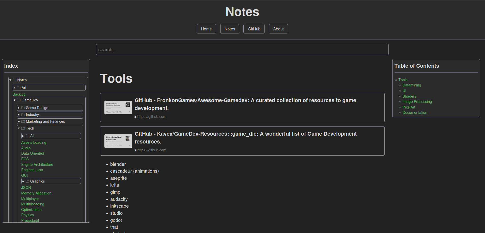

# ✨ Markdown to HTML Converter (md-to-html.py)

An easy tool written in Python that turns your Markdown folders into a clean static website. It adds an index menu, a table of contents, search functionality, and preview cards.



---

## 🛠️ What It Does

* **📄 Converts Markdown Files:** Turns `.md` files into clean `.html` pages.
* **🧭 Smart Navigation:** Automatically builds sidebar menus based on your folder structure.
* **📑 Table of Contents:** Generates a Table of Contents for every page.
* **🔍 Live Search:** Includes an instant search bar to help users find content quickly.
* **🃏 Rich Preview Cards:** Automatically creates preview cards for external links, YouTube videos, and GitHub repositories.
* **⚡ Fast Processing:** Uses multiple CPU cores to process and convert files quickly.

---

## 📦 Requirements

* Python 3.6 or higher
* The `markdown` package (listed in `requirements.txt`)


---

## ⚙️ Styling (`base.css` and Custom CSS)

The project handles styling using two main mechanisms:

* **`base.css`:** This is the core stylesheet included by default (located alongside the script) that defines the main structure, dark/light theme variables, grid layouts, sidebar styles, notice boxes, and mobile responsiveness.


* **Custom CSS (`css_file_path`):** You can define an extra custom stylesheet path inside your `md-to-html_config.json` file. The script automatically copies both `base.css` and your custom CSS file into the output directory so your site inherits all styles seamlessly.


---

## 📥 How to Install

1. Download or clone this repository.
2. Install the required Python package:
```bash
pip install -r requirements.txt

```


---

## 💻 How to Use

1. Update your settings in `md-to-html_config.json` (such as input and output folders, and custom CSS paths).


2. Run the script from your terminal by passing the config file as an argument:
```bash
python md-to-html.py md-to-html_config.json

```


3. Find your generated website inside your designated output folder!
